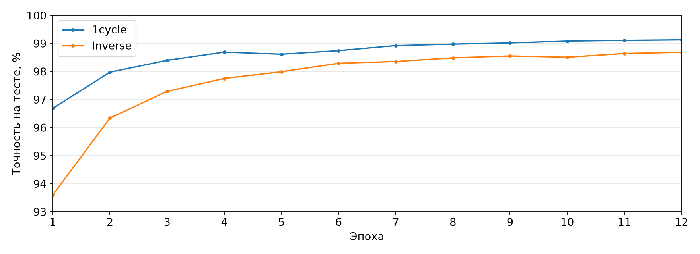

# Воспроизведение Super-Convergence на MNIST

Статья: Leslie N. Smith, Nicholay Topin. Super-Convergence: Very Fast Training of Neural Networks Using Large Learning Rates, 2018. https://arxiv.org/abs/1708.07120

## Что проверялось

Авторы предлагают обучать сеть с одним циклом learning rate. Сначала он растет до значения, которое обычно считают слишком большим, затем падает ниже начального. Momentum меняется в обратную сторону. По статье большой learning rate сам по себе действует как регуляризатор и позволяет заметно сократить обучение.

Я повторил опыт из таблицы 2 на MNIST и LeNet. В статье 1cycle дает 99.25% точности за 12 эпох. Обычное обучение с убывающим learning rate дает 99.03% за 85 эпох. Для сравнения при равном бюджете я также обучил обычный вариант 12 эпох.

## Постановка эксперимента

MNIST содержит 60 000 обучающих и 10 000 тестовых изображений. Сеть взята из примера LeNet в Caffe: две свертки с max pooling, полносвязный слой на 500 нейронов и выход на 10 классов. Перед подачей в сеть значения пикселей делятся на 256.

Во всех трех вариантах использовались SGD, размер батча 512 и weight decay 0.0005. Для bias learning rate был вдвое выше, как в конфигурации Caffe. Обычный вариант использовал momentum 0.9 и inverse schedule с начальным learning rate 0.01, gamma 0.0001 и power 0.75.

В 1cycle learning rate рос с 0.01 до 0.1 в первые 5 эпох, возвращался к 0.01 за следующие 5 эпох и снижался до 0.0001 в последние 2 эпохи. Momentum менялся с 0.95 до 0.8 и обратно. Конечный learning rate для последних двух эпох в таблице статьи не задан. Значение 0.0001 является выбором этой реализации.

Я запустил эксперимент с seed 0, 1, 2, 3 и 4. Для каждого seed начальные веса и порядок обучающих примеров совпадали между режимами. В таблице ниже указана точность после последней эпохи. SD означает выборочное стандартное отклонение пяти запусков. Время включает только обучение, без скачивания данных и оценки тестового набора.

## Результаты

| Режим | Эпохи | Точность, среднее | SD | Время, среднее |
| --- | ---: | ---: | ---: | ---: |
| 1cycle | 12 | 99.128% | 0.032 п.п. | 30.38 с |
| Inverse schedule | 12 | 98.686% | 0.062 п.п. | 30.01 с |
| Inverse schedule | 85 | 99.024% | 0.015 п.п. | 212.09 с |

При одинаковых 12 эпохах 1cycle дал на 0.442 процентного пункта больше. По сравнению с 85 эпохами обычного обучения разница составила 0.104 пункта, а время обучения сократилось в 6.98 раза. 1cycle был лучше длинного обычного режима на каждом из пяти seed. Разница по seed находилась от 0.08 до 0.14 пункта.

В статье для этих двух режимов указаны 99.25% и 99.03%. Обычный режим у меня почти совпал с результатом статьи: 99.024% против 99.03%. Для 1cycle получилось 99.128% против 99.25%. Ускорение удалось повторить, но выигрыш по точности меньше: 0.104 пункта вместо 0.22.

## Ограничения и вывод

Исходный эксперимент выполнен в Caffe, а эта реализация использует PyTorch 2.14.1 на MPS. Для последнего участка 1cycle пришлось выбрать конечный learning rate, так как статья не приводит его точное значение для MNIST. Эти различия могут влиять на точность, но без отдельного сравнения я не могу назвать причину расхождения в 0.122 пункта.

На всех пяти seed 1cycle оказался точнее обычного обучения за 85 эпох. Я проверял только MNIST и LeNet, поэтому по CIFAR и ImageNet здесь выводов нет. В моем запуске 1cycle дал немного более высокую точность примерно за одну седьмую времени обучения.

## Как повторить

Из корня папки выполнить `python train.py --seeds 0 1 2 3 4`. Скрипт сам скачает MNIST и сохранит итоговые строки, метрики по эпохам и сведения об окружении в новой папке `results/`. В этом отчете использованы файлы из `results/20261009-151838/`.

Источники: статья https://arxiv.org/html/1708.07120v3, конфигурация LeNet https://github.com/BVLC/caffe/blob/master/examples/mnist/lenet_train_test.prototxt, конфигурация SGD https://github.com/BVLC/caffe/blob/master/examples/mnist/lenet_solver.prototxt.
